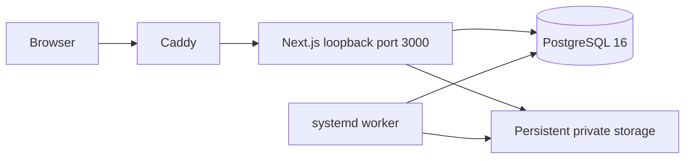
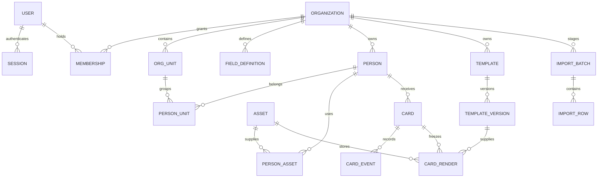

# Architecture

One TypeScript codebase builds a Next.js application, worker and administrative CLI. PostgreSQL owns authoritative business records and the pg-boss queue. Assets are private files addressed by generated keys; the database retains ownership, dimensions and hashes.

## Data relationships

Typed custom-field definitions validate values stored in each person's JSONB object. This is a deliberate simplification from the conceptual FIELD_VALUE table in Step 0: a person update remains atomic, dynamic values are indexed with GIN and original types are preserved. There is no fixed business limit on field definitions; request/file resource bounds still apply.

Every tenant-owned business table has `organization_id`; forced row-level policies compare it with a transaction-local context. Tenant references use composite foreign keys. Organizations, users and membership lookup support authorization before entering a tenant transaction. Application queries never grant a caller an arbitrary tenant context without checking membership or global Super Admin access.

## Rendering

The browser edits a validated template document. It does not upload executable canvas state, arbitrary SVG markup, external image URLs or scripts. The server resolves bindings into text, shapes and private asset references, builds controlled SVG and rasterizes through sharp.

Geometry uses mm; pixels are derived from explicit DPI. The browser editor is an editing aid: binding labels and QR/barcode placeholders become real data/codes in the authoritative server preview. Text uses conservative wrapping and rejects overflow. QR and linear-code preflight guards size, quiet zones, contrast and valid data.

Generation locks the organization sequence, renders inside the transaction, creates immutable output assets, records a DRAFT card and appends an immutable snapshot/event. A failed transaction cannot leave a half-created card in the database. A failure after writing files can leave an unreferenced private file; automatic garbage collection is not enabled, so it cannot accidentally delete historical data. Monitor storage until later operational cleanup is implemented.

Generated images preserve physical DPI and remain bound to immutable template versions. Changing a template, source person or photo never regenerates an existing render. PDFKit embeds frozen PNG output at exact physical dimensions into streamed PDFs; Chromium is used only in development browser tests.

## Worker

The worker initializes pg-boss, maintains a heartbeat and performs actual expired-session/rate-window cleanup. Bulk jobs pin immutable input snapshots and stable card IDs, commit per item, resume pending work after restart, and use session advisory locks plus a durable dispatch loop. Export jobs use frozen renders and private atomic files.

## Modules

- `src/core`: configuration, DB transactions, authentication, authorization, imports, assets, binding/rendering, numbering, diagnostics and demo seeding.
- `src/components`: workspace, front/back editor, photo controls and numbering settings.
- `src/app`: pages and a common REST dispatcher.
- `src/db/migrations`: checksummed additive database migrations.
- `src/worker`, `src/cli`: service and operations entry points.
- `deploy`: real systemd/Caddy configuration and installer support.
- `tests`: renderer/unit tests, real PostgreSQL workflows and headless browser verification.

Later phases add export/imposition, bulk jobs, verification, maps, lifecycle, dashboard, audit hardening and complete recovery operations without changing the two-process deployment model.

Phase 20 operations use a privileged CLI boundary, root-only staging/backup directories, PostgreSQL administrator capture/restore for forced-RLS completeness, staged database/storage switching and readiness checks. Web/worker remain non-root. Public verification uses only an opaque hash-to-tenant registry to enter an isolated tenant transaction. API tokens use a separate opaque registry; current user permissions and explicit token scopes both apply.
